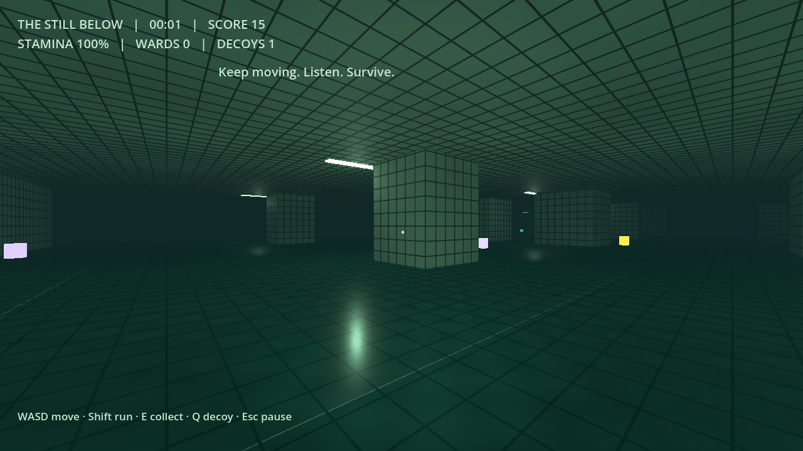

# The Still Below — نسخة Mac الأولى

لعبة رعب وبقاء أصلية بمنظور الشخص الأول، داخل مسبح مهجور يتولّد تدريجياً. الهدف: البقاء أطول مدة، وجمع الإمدادات، وتفادي كائن يسمع خطواتك ويراك من قرب وتزداد سرعته مع الوقت.

**الإصدار المستخدم والمختبَر: Godot 4.6.3 Standard، GDScript**
معرّف المحرك: `4.6.3.stable.official.7d41c59c4`، وضع العرض **Compatibility**.
لا تحتاج نسخة .NET، أو إضافات، أو تنزيل حزم، أو حسابات، أو اتصال بالإنترنت أثناء اللعب.

## التشغيل على MacBook بالترتيب

1. افتح [صفحة الإصدار الرسمي Godot 4.6.3](https://godotengine.org/download/archive/4.6.3-stable/).
2. اختر **Standard → macOS**، وليس .NET. التنزيل الرسمي Universal يدعم Apple Silicon وIntel.
3. فك ضغط المحرر وانقل `Godot.app` إلى Applications، ثم افتحه. إذا طلب macOS التأكيد لبرنامج تم تنزيله، اتبع رسالة النظام بعد التأكد من أن التنزيل من الموقع الرسمي.
4. فك ضغط ملف المشروع `The-Still-Below-Godot-4.6.3.zip` إلى مجلد محلي قابل للكتابة، مثل Documents. لا تفتح الملفات من داخل ZIP.
5. في مدير مشاريع Godot اضغط **Import**، ثم اختر ملف `project.godot` الموجود داخل مجلد `horror-pool-game`.
6. اضغط **Import & Edit** وانتظر اكتمال استيراد المشروع. لا تغيّر المحرك إلى Forward+؛ المشروع مضبوط على Compatibility لتوسيع التوافق.
7. اضغط **▶ Run Project** أعلى المحرر، أو `F5` (قد تحتاج `Fn + F5` بحسب إعداد لوحة مفاتيح Mac). `F6` يشغّل المشهد الحالي فقط؛ استخدم Run Project.
8. من شاشة اللعبة اضغط **ENTER THE WATER**. يلتقط المؤشر وتبدأ الجولة. انقر داخل نافذة اللعبة إن لم تستقبل لوحة المفاتيح.
9. اضغط `Esc` لإيقاف اللعب مؤقتاً وتحرير الفأرة. اختر **RESUME** للعودة. عند الخسارة اضغط **TRY AGAIN** ثم ابدأ الجولة من جديد.

**التجربة المحلية مجانية ولا تحتاج حساب مطوّر Apple أو Xcode أو Android Studio أو قوالب التصدير.** التسليم هنا مشروع يعمل من المحرر؛ ليس تطبيق `.app` موقّعاً ولا APK. تأتي مرحلة أندرويد بعد تجربة هذه النسخة.

## التحكم

| الوظيفة | الزر |
| --- | --- |
| الحركة | W A S D أو الأسهم |
| النظر | الفأرة / حركة المؤشر على لوحة اللمس |
| الجري | الاستمرار على Shift أثناء الحركة |
| جمع العنصر القريب | E |
| إسقاط طُعم صوتي | Q |
| الإيقاف المؤقت وتحرير المؤشر | Esc |

يمكن تغيير اتجاه النظر بلوحة اللمس، لكن الفأرة أريح. ينفد التحمّل أثناء الجري، ويجب أن يتعافى إلى 25% بعد الإرهاق. المشي أقل ضجيجاً من الجري، وليس صامتاً تماماً.

## قواعد البقاء

- كل ثانية تمنح 10 نقاط، وكل عنصر مجموع يمنح 150 نقطة.
- **السماوي — Ward:** حماية من ضربة واحدة، تتبعها مهلة أمان لخمس ثوانٍ.
- **الذهبي — Breath flask:** يعيد التحمّل إلى 100%.
- **البنفسجي — Noise decoy:** يضيف طُعماً. اضغط Q لإسقاطه عند مكانك، ثم ابتعد؛ يجذب الوحش عشر ثوانٍ. تبدأ الجولة بطُعم واحد.
- التفاعل متاح على مسافة نحو 2.4 متر، ويظهر وصف العنصر عند الاقتراب.
- يسمع الوحش المشي ضمن 11 متراً والجري ضمن 32 متراً. يراك ضمن 9 أمتار إذا لم يحجبك جدار أو عمود. يتذكر آخر ضجيج ويستخدم A* لتجاوز العوائق؛ الطُعم له أولوية مؤقتة.
- تبدأ سرعته عند 1.55 متر/ثانية، وتزداد 0.012 كل ثانية إلى حد 4.7. لا يوجد مخرج أو شاشة فوز في وضع البقاء هذا؛ تنتهي الجولة عند الإمساك بك دون حماية.

## ما تتضمنه النسخة

- مناطق ثلاثية الأبعاد بحجم 32×32 متراً، ماء متموج، بلاط، أعمدة، حواجز وممرات، سقف وإضاءة وضباب.
- توليد المناطق المحيطة باللاعب عند الحركة وحذف البعيدة؛ لا تُنشأ خريطة غير محدودة دفعة واحدة. التوليد حتمي، بتصميم معماري متكرر مقصود في هذه النسخة الأولية.
- وحش أصلي مبني من أشكال هندسية، مطاردة وسماع ورؤية وطُعم وتصاعد صعوبة.
- مؤقت ونقاط وتحمّل ومخزون وعناصر، وقائمة بدء وإيقاف وخسارة وإعادة لعب.
- موسيقى توتر منخفضة وصوت خطوات مائية ونغمات للعناصر ونبض/زمجرة يشتدان مع اقتراب الوحش. جميع الأصوات تُركّب برمجياً؛ ابدأ بصوت منخفض وارفعه تدريجياً.
- أساس تحكم لمس: السحب في الجهة اليسرى للحركة، واليمنى للنظر، وأزرار Run / Take / Decoy عند اكتشاف شاشة لمس. لم تُختبر على أندرويد بعد؛ لا تُعد نسخة الهاتف جاهزة.

## الاختبارات وحدود التحقق

أُجري التحقق باستخدام Godot 4.6.3 على Linux داخل بيئة التطوير، وليس على جهاز Mac حقيقي. شمل ذلك تشغيل منطق اللعبة، الحركة والتصادم، توليد المناطق، ذكاء الوحش والعناصر والخسارة، وعرض OpenGL فعلي باستخدام برمجيات Mesa مع التقاط صور. الصوت أصلي ومولّد أثناء التشغيل؛ مستوى الصوت وجودته على سماعات Mac والأداء والتحكم يحتاجان تجربتك الفعلية.



لتشغيل الاختبارات الاختيارية من Terminal بعد تثبيت المحرر في Applications:

```bash
cd /path/to/horror-pool-game
/Applications/Godot.app/Contents/MacOS/Godot --headless --path . --script res://tests/smoke.gd
```

النتيجة المتوقعة: `SMOKE COMPLETE` مع عدد الفحوص وبدون `FAIL`. قد يختلف اسم مجلد تطبيق Godot إن غيّرته عند التثبيت. لا تحتاج Terminal للعب.

## الملفات والتعديل

- `project.godot` و`main.tscn`: إعدادات المشروع والمشهد الرئيسي.
- `scripts/game.gd`: التوليد والحركة والوحش والعناصر والقوائم وتحكم اللمس.
- `scripts/sound.gd`: تركيب الأصوات والموسيقى أثناء التشغيل.
- `scripts/joystick.gd`: رسم مؤشر عصا اللمس.
- `shaders/`: خامتا الماء والبلاط الأصليتان.
- `tests/`: اختبارات سلوك اللعبة وأداة التقاط صور العرض.
- `docs/`: صور فعلية وسجل التحقق ومصدر الأصول.

تُنشأ `.godot/` تلقائياً عند الاستيراد؛ ليست مطلوبة في ملف التسليم. لا توجد مكتبات خارجية أو مفاتيح سرية. أرسل لاحقاً طراز MacBook، وإصدار macOS، وما لاحظته في الأداء والتحكم والصوت والصعوبة قبل الانتقال إلى APK.
